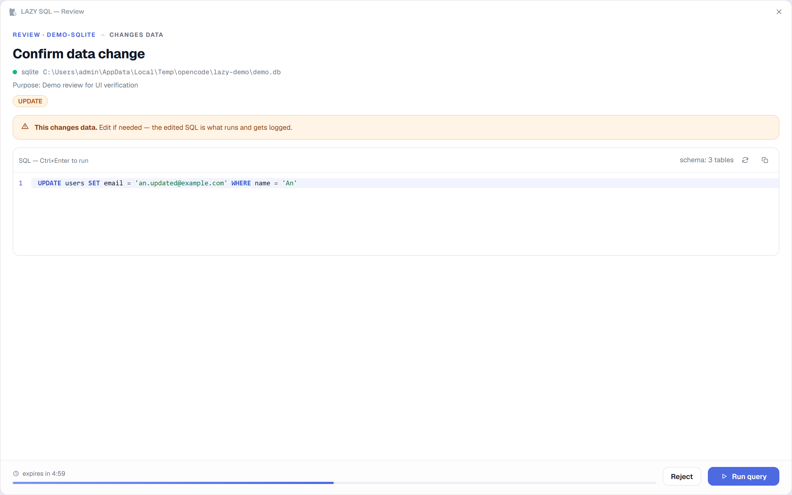

# LAZY SQL

[](LICENSE)
[](#requirements)
[](https://modelcontextprotocol.io)
[](https://sondv5.github.io/lazy-sql/)

**LAZY SQL** gives your AI coding tools reviewed access to your databases.

 Read-only SQL runs instantly; **everything that changes data opens a review dialog first**. It is the next generation of the local `sql-mcp`: same multi-database engine (PostgreSQL / MySQL / SQL Server / SQLite), with a lightweight Tauri desktop app for connections, a full SQL workspace, execution logs, AI tool toggles and the review dialog.

```
[ AI tool: OpenCode · Claude Code · Cursor · Codex · Gemini CLI · VS Code · … ]
        │  stdio MCP
        ▼
[ LAZY SQL engine (Node, single bundled file) ]
   ├── execute_sql        → read-only: runs instantly (logged)
   │                        writes: spawns the REVIEW DIALOG window, waits for approval
   ├── get_db_objects     → schema introspection for agents
   └── open_db_config     → opens the desktop app (browser fallback)
        │  local HTTP API (127.0.0.1 + per-session token)
        ▼
[ LAZY SQL desktop app (Tauri 2 — ~10 MB shell, system webview) ]
   ├── Main window   → connections · SQL workspace · logs · AI tools · settings
   └── --review mode → frameless dialog window (no other window), spawned per review
```

## Highlights

- **Review dialog, not a popup page** — the engine session that requests a review spawns the app in dialog mode itself: a single frameless window (docked to the right edge, focused when it opens — not always-on-top) with an editable SQL editor: syntax highlighting, schema-aware autocomplete (CodeMirror 6), statement badges, danger warnings, expiry countdown, live execution results. Nothing runs until you click **Run query** — and the edited SQL is what executes and gets logged. The main app never needs to be open; without the app installed, reviews fall back to a browser page. Rejecting — or letting the review expire — closes the dialog automatically.
- **Full SQL workspace** — object explorer (tables, views, functions, procedures, triggers; columns, PK/FK, indexes and definitions), data preview, multi-tab queries, selection runs, query plans (`EXPLAIN`), saved queries, recent execution history, row caps, and CSV/JSON export. Read-only connections block writes here too, and every manual run lands in the execution log (tagged `manual`).
- **Main window = settings + logs** — connection manager (add/edit/test/delete), multi-database support, execution history by date with table/raw payload inspection. Reviews never surface in the main window — they belong to the engine session that requested them.
- **Enable/disable per connection + read-only mode** — every connection has an `enabled` flag (agent visibility) and a `read-only` flag (writes blocked server-side *and* at the driver session level). `LAZY_SQL_FORCE_READ_ONLY=1` locks a whole session read-only.
- **Per-tool MCP toggles** — register or remove the LAZY SQL MCP server for **OpenCode, Claude Code, Cursor, Windsurf, VS Code (Copilot), GitHub Copilot CLI, OpenAI Codex, Gemini CLI, Qwen Code, Kiro, Cline, Roo Code, Kilo Code, JetBrains Junie, Factory Droid, Zed and Amazon Q Developer** at user scope — one toggle per tool, no per-folder setup. Pick which connections that tool may use. Tool configs are edited as text with a minimal diff — comments, key order, indentation and formatting of everything else stay exactly as you wrote them (JSON/JSONC, plus Codex TOML) — and the first edit of a file keeps the untouched original as `<file>.lazy-sql-backup` (never overwritten by later edits).
- **Import / export connections (.json)** — all connections travel as one `.json` file; passwords opt-in only (`${ENV_VAR}` placeholders preferred); conflict handling on import: skip / overwrite / keep-both.
- **Logs on every run** — read queries, approved writes (final SQL + params), rejections, timeouts and blocks are all written to a local JSONL log with the exact payload returned to the agent. Browse by date, filter by status, copy the SQL.
- **Frameless custom chrome** — no native title bar: custom window buttons, macOS traffic-light style on mac, rounded corners; system tray with show/quit; close-to-tray option.
- **Works on macOS & Windows** — Tauri 2 + system webview; the same engine bundle powers both (and plain Node for the MCP processes).

## Requirements

- **Node.js ≥ 22.5** (the engine — spawned by your AI tools and by the app)
- Desktop app: **Windows 10/11 (WebView2)** or **macOS 10.15+** (WKWebView)
- Building the app from source: Rust toolchain (stable) + platform Tauri prerequisites. Build for macOS **on macOS**, Windows **on Windows**. Prebuilt installers (Windows NSIS/MSI, macOS universal `.dmg`) are attached to GitHub releases — CI builds them from a version tag.

## Quickstart

```powershell
npm install                 # install engine + app workspaces
npm run bundle              # bundle engine → single file (engine/dist + tauri resources)
npm run dev                 # engine daemon (http://127.0.0.1:4788) + web UI (http://127.0.0.1:1420)
npm run dev:app             # desktop app in dev mode (Tauri shell + vite)
npm run build:app           # production installers (NSIS/MSI on Windows, .dmg/app on macOS)
npm test                    # engine unit + integration smoke tests
```

Releases & CI: every push runs the test suite on GitHub Actions; pushing a tag (`git tag v0.2.0 && git push --tags`) builds the Windows (NSIS + MSI) and macOS (universal `.dmg`) installers and attaches them to the release.

Dev tips:

- **Web dev mode** runs the full UI in a browser: open `http://127.0.0.1:1420/?engine=4788&token=<engine token>` (the token is printed by the engine at start; when the app spawns the engine you don't need this).
- `node engine/test/demo-review.mjs` creates a real pending review against a running demo setup and spawns the actual review dialog (handy to try it end-to-end).
- `node engine/test/demo-review.mjs delete` uses a DELETE statement instead of UPDATE.

## Register the MCP server

The easiest way is **AI tools** in the app: flip the toggle next to each tool and choose the connection scope. It registers the tool at user scope, so the same setup works in every project. Manual examples:

**OpenCode** (`opencode.json`)

```json
{
  "mcp": {
    "lazy-sql": {
      "type": "local",
      "command": ["node", "D:\\path\\to\\lazy-sql\\engine\\src\\index.js"],
      "enabled": true,
      "environment": { "LAZY_SQL_ALLOWED_CONNECTIONS": "staging-db,prod-replica" }
    }
  }
}
```

**Cursor** (`~/.cursor/mcp.json`) · **Claude Code** (`~/.claude.json`) · **Kiro** (`~/.kiro/settings/mcp.json`) · **Windsurf** (`~/.config/devin/mcp_config.json`) · **Gemini CLI** (`~/.gemini/settings.json`) · **Qwen Code** (`~/.qwen/settings.json`) · **Junie** (`~/.junie/mcp/mcp.json`) · **Factory Droid** (`~/.factory/mcp.json`) · **Cline/Roo/Kilo** (VS Code globalStorage):

```json
{
  "mcpServers": {
    "lazy-sql": {
      "command": "node",
      "args": ["D:\\path\\to\\lazy-sql\\engine\\src\\index.js"],
      "env": { "LAZY_SQL_FORCE_READ_ONLY": "1" }
    }
  }
}
```

**VS Code** uses the `"servers"` key, **Zed** uses `"context_servers"` (with `command.path` / `command.args`), and **OpenAI Codex** uses a TOML table:

```toml
[mcp_servers."lazy-sql"]
command = "node"
args = ["D:\\path\\to\\lazy-sql\\engine\\src\\index.js"]
env = { LAZY_SQL_FORCE_READ_ONLY = "1" }
```

The AI tools page writes the correct shape for each client automatically.

## Storage & environment

All local, nothing leaves the machine. Data lives in **`~/.lazy-sql`** (Windows: `C:\Users\<you>\.lazy-sql`). Upgrading from a build that still used `~/.sql-crew`? The folder is moved automatically on first start (kept in place only if it cannot be moved, e.g. locked files).

| File | What |
| --- | --- |
| `connections.json` | connections (0600; passwords plaintext by design — prefer `${ENV_VAR}`) |
| `app-settings.json` | review timeout, fallback behavior, tray, desktop app path |
| `workspaces.json` | desired per-tool MCP toggle state (older builds also stored project folders here) |
| `execution-log.jsonl` | execution history (10 MB cap, last 5000 entries) |
| `instances/` | live session registry (each engine instance heartbeats) |
| `engine.log` | daemon stderr (when spawned by the desktop app) |

| Environment variable | Default | Purpose |
| --- | --- | --- |
| `LAZY_SQL_DATA_DIR` | `~/.lazy-sql` | Where all data lives |
| `LAZY_SQL_PORT` | `4788` | Preferred local API port (auto-increments when busy) |
| `LAZY_SQL_TOKEN` | random per start | Local API token |
| `LAZY_SQL_REVIEW_TIMEOUT_MS` | `600000` | Review auto-reject timeout |
| `LAZY_SQL_ALLOWED_CONNECTIONS` | all enabled | Comma-separated connection ids or names (`*` or unset = all). The app writes ids, so renaming a connection never changes who can use it. A list with no usable entry allows **nothing** |
| `LAZY_SQL_FORCE_READ_ONLY` | – | `1` = every connection in this session is read-only |
| `LAZY_SQL_INSTANCE_LABEL` | – | Label shown in “Live agent sessions” |
| `LAZY_SQL_MAX_RESPONSE_CHARS` | `50000` | Agent response budget (rows trimmed with hints) |
| `LAZY_SQL_NO_OPEN` | – | `1` = never open windows (tests) |

The pre-rename `SQL_CREW_*` names are still accepted as a fallback (new name wins), so tool configs written by older versions keep their scope — re-toggle the tool in the app to migrate them to `LAZY_SQL_*`.

## MCP tools

| Tool | Behavior |
| --- | --- |
| `execute_sql` | Read-only statements (`SELECT`, `WITH…SELECT`, `SHOW`, `EXPLAIN`, `PRAGMA`, `DESCRIBE`) run immediately. Writes/DDL/CALL/unknown open the review dialog. Two-phase: returns `pending_review`/`running` with a `reviewId`; call again with only the `reviewId` to fetch the outcome. |
| `get_db_objects` | List/describe tables, views, functions, procedures, triggers — columns, PKs, FKs, indexes, definitions. |
| `open_db_config` | Opens the connection manager in the desktop app (browser fallback). |

## Security model

- Review dialog = human approval for every data/schema change; read-only connections are blocked **before** any dialog opens.
- Local API binds `127.0.0.1` only, every call requires the per-session token; CORS is limited to local origins.
- Errors returned to agents have credentials scrubbed; the API never returns passwords (`hasPassword` flag only).
- Tool config edits are atomic, minimal and backed up once (`.lazy-sql-backup` = the original); files that fail to parse are never touched — the app shows a snippet to paste manually instead. Choosing no connection is refused rather than treated as "all". Committed to git? Only what you commit — `~/.lazy-sql` lives outside your repos.

## Project layout

```
engine/               Node MCP server + local HTTP API (no Electron)
  src/                classify · executor (pg/mysql2/mssql/node:sqlite) · objects · schema
                      reviews · exec-logs · instances · settings · transfer · workspaces
  test/               unit + end-to-end stdio smoke tests
  scripts/bundle.mjs  esbuild → single-file engine (~5.6 MB, pure JS, system Node)
apps/desktop/         Tauri 2 desktop app
  src/                vanilla TS + CodeMirror 6 frontend (no framework overhead)
  src-tauri/          Rust shell: tray, frameless windows, engine supervision
scripts/dev.mjs       dev orchestrator (engine daemon + vite)
```

## Why Tauri (and not Electron)?

The desktop shell is a few MB and uses the OS webview (WebView2/WKWebView) instead of shipping a browser. The heavy lifting (drivers, review state, logs) stays in the Node engine — which must exist anyway for the MCP stdio protocol — so the shell stays thin and both platforms share 100% of the logic.

## License

[MIT](LICENSE) © 2026 Son Dong Van (sondv5)
